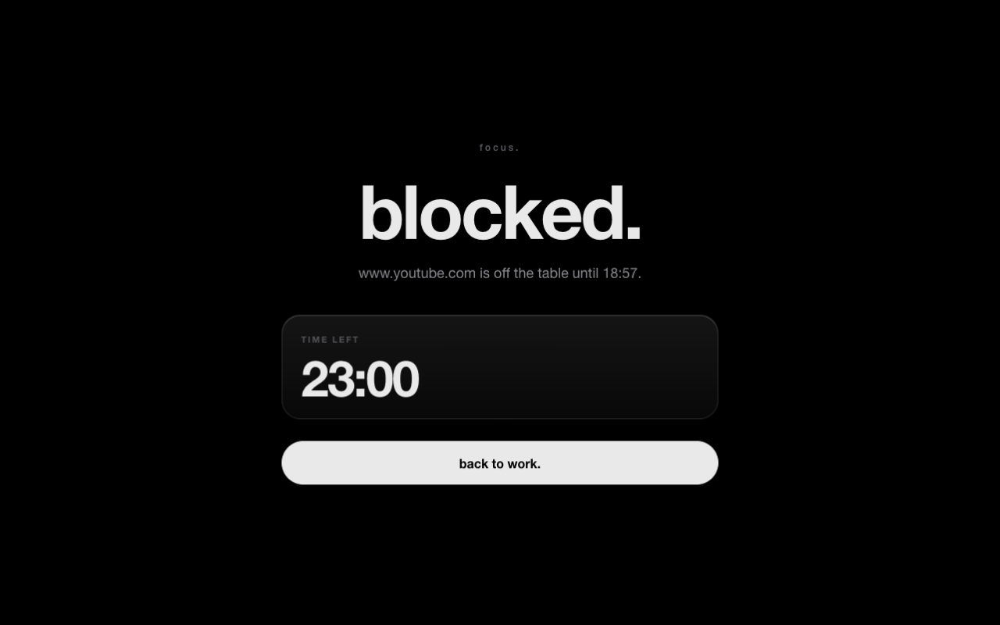

<p align="center"></p>

<h1 align="center">Focus</h1>

<p align="center">A macOS menu-bar app and browser extension that blocks distracting sites and apps during focus time.</p>

<p align="center">
  
  
  
  
</p>

## What it is

Focus blocks the websites and apps you choose for a set period, either started by hand or on a weekly schedule.
It runs as a menu-bar app under your own user account, needs no root access, and leaves nothing behind when you uninstall it.
Browser blocking works through a small Manifest V3 extension that talks to the app over a localhost connection.

## Features

- **Modes** group domains and apps, for example Work, Personal or Training.
- **Sessions** start a block now for 15 minutes, 30 minutes, 1 hour, 2 hours, 4 hours, a custom length, or until a clock time.
- **Schedules** repeat a block on chosen weekdays and times, including overnight ranges.
- **App blocking** closes blocked apps while a block is active.
- **Browser blocking** works in Arc and in the Search browser (WebKit) through the extension. Other well-known browsers
  (Safari, Chrome, Firefox and similar) are closed during a block.
- **Emergency exit** ends a block early, but only after friction: you type a random phrase exactly, wait for a set time
  (15 minutes by default), and give a reason of at least 20 characters.
- **Tamper resistance:** rules only get stricter during a block. You cannot shorten it, remove blocked sites or apps,
  or change the schedule that started it. Adding sites and apps is always allowed. Block timing uses a trusted clock, so changing the system time does not end a block.
  If the app is not running, the extension keeps enforcing its last rules until the block ends.
- **Zero-trace install:** no root, no system files touched, and no network requests or telemetry. See [Footprint](#footprint).

## Screenshot

<p align="center"></p>

## Requirements

- macOS 26 or later
- Xcode 26 or the Swift 6.2+ toolchain (for `swift`, `xcrun actool`)

## Install

```sh
./scripts/install.sh
```

The script builds `build/Focus.app`, copies it to `~/Applications/Focus.app`, and starts it as a LaunchAgent so it runs at login.
If the build fails, nothing is changed.

Re-running the script is safe. It stops any running Focus, removes traces of the previous install
(old app, LaunchAgent, preferences, caches, and obsolete API key files from earlier versions) and reinstalls.
Your state and history are kept. The script waits up to 10 seconds for the app to start and for the browser bridge
to listen on `127.0.0.1:47823`, and exits with an error if either does not happen.

Then [load the browser extension](#load-the-browser-extension).

## Load the browser extension

**Arc**

1. Open `arc://extensions`.
2. Enable **Developer mode**.
3. Click **Load unpacked** and choose the `extension/` folder of this repository.

**Search**

1. Open the extension settings in Search.
2. Choose the `extension/` folder of this repository.

Search copies the extension when you add it, so after any change to the extension you must remove Focus in Search's
extension settings and add the folder again. Bump `version` in `extension/manifest.json` first. Search only refreshes its copy
when the version changes, so an edit with the same version is not picked up even after re-adding the folder.
Arc reads the folder directly, so reloading the extension there is enough.

The extension talks to the app at `ws://127.0.0.1:47823`. Without the app, it keeps enforcing the last rules it received until the block ends.

## Usage

- Open the Focus menu-bar icon to see whether a block is active and which browsers are connected.
- Start a session with **Start Session**, choosing a mode and a duration.
- Add schedules and edit modes in **Settings** (⌘,). Blocked sites are entered one per line; apps are added from `/Applications`.
- During a block, **Emergency Exit…** appears in the menu if emergency exit is enabled. The wait, phrase length and
  whether emergency exit is enabled are set in **Settings > General**.
- While a block is active, Focus cannot be quit.

## Uninstall

```sh
./scripts/uninstall.sh
```

Uninstall is refused while a block is active. `./scripts/uninstall.sh --force` overrides that.

The script is idempotent. It stops Focus, removes the app, the LaunchAgent, the data folder and the macOS preferences and caches,
and prints each path it removed. It finishes with a leftover scan that lists anything still present or still running, and exits non-zero if it finds any.

Remove the browser extension yourself in Arc (`arc://extensions`) and in Search's extension settings.

## How it works

- **Menu-bar app** (`Sources/Focus`, SwiftUI and AppKit) holds the modes, schedules and sessions, and decides what is blocked at any moment.
  Its state lives in `~/Library/Application Support/Focus/`.
- **Bridge** is a WebSocket server bound to `127.0.0.1:47823` only. The extension connects to it and sends a heartbeat.
  The app identifies each connection by the app that owns it (not by the browser's Origin or user agent), and ignores connections that
  it cannot verify as a supported browser. The app sends the current block rules to each verified connection.
- **Extension** (`extension/`, plain JavaScript) redirects tabs on blocked domains to a local block page showing the remaining time. It
  enforces the last rules it received until the block ends, even if the connection drops.
- **App blocking** uses `NSWorkspace` to watch launches and activations and terminates blocked apps during a block.
- **Core logic** (`Sources/FocusCore`) is pure Swift with no AppKit or SwiftUI, so it is covered by unit tests.

## Footprint

| Path | Created by | Removed by |
| --- | --- | --- |
| `~/Applications/Focus.app` | install.sh | uninstall.sh |
| `~/Library/LaunchAgents/com.pol.focus.plist` | install.sh | uninstall.sh |
| `~/Library/Application Support/Focus/` (state.json, history.jsonl, active-block-until) | the app | uninstall.sh |
| `~/Library/Application Support/Focus/apikey`, `apikey-gatekeeper`, `apikey-verifier` (obsolete key files) | an earlier version | install.sh and uninstall.sh |
| `~/Library/Preferences/com.pol.focus.plist` | macOS, only if created | install.sh (old traces) and uninstall.sh (defensive) |
| `~/Library/Caches/com.pol.focus/` | macOS networking, if created | install.sh (old traces) and uninstall.sh (defensive) |
| `~/Library/HTTPStorages/com.pol.focus*` | macOS networking, if created | install.sh (old traces) and uninstall.sh (defensive) |
| `~/Library/Saved Application State/com.pol.focus.savedState` | macOS, if created | install.sh (old traces) and uninstall.sh (defensive) |
| `~/Library/WebKit/com.pol.focus/` | macOS, if created | install.sh (old traces) and uninstall.sh (defensive) |
| `~/Library/Application Scripts/com.pol.focus/` | macOS, if created | install.sh (old traces) and uninstall.sh (defensive) |
| `~/Library/Containers/com.pol.focus/` | macOS, if created | install.sh (old traces) and uninstall.sh (defensive) |
| Privacy (TCC) permission entries | macOS, if the app requests any | `tccutil reset All com.pol.focus` in install.sh and uninstall.sh |
| `build/` in the repository | build.sh | delete the folder (or the repo) |
| Browser extension | you, when loading it | remove it in Arc / Search |

The app keeps its data in its own folder, does not use `UserDefaults`, makes no network requests to any service,
and does not run as root.

## Project layout

```
Package.swift                    SwiftPM manifest (macOS 26, Swift 6.2 tools)
Sources/FocusCore/               pure logic: models, store, engine, trusted clock, durations
Sources/Focus/App/               @main app entry point
Sources/Focus/System/            AppController, AppBlocker, BridgeServer, OverlayController
Sources/Focus/UI/                SwiftUI views: menu, settings, block/emergency/warning overlays, theme
Tests/FocusCoreTests/            unit tests for the core logic
extension/                       MV3 browser extension (manifest, background, content script, block page)
scripts/                         build.sh, install.sh, uninstall.sh, lib.sh
assets/                          app icon source, extension icon sources, logo and screenshot
SPEC.md, DESIGN.md               internal specification and design notes
```

## Development

```sh
swift build           # debug build
swift test            # unit tests for FocusCore
scripts/build.sh      # release build into build/Focus.app (signed ad hoc)
```

- **App icon:** edit `assets/AppIcon.icon` in Icon Composer (Xcode > Open Developer Tool > Icon Composer).
  `scripts/build.sh` compiles it with `actool`, so nothing needs regenerating for the app.
- **Browser extension icons:** edit the SVGs in `assets/extension/` and run `bash assets/make-extension-icons.sh`.
- **Pre-commit hooks:** install `pre-commit` (`brew install pre-commit`), then run `pre-commit install`.
  The hooks run gitleaks and ggshield for secrets, block private keys and large files, and check for merge conflicts.

For internal conventions, see [SPEC.md](SPEC.md) (behavior and build contract) and [DESIGN.md](DESIGN.md) (visual design).

## Troubleshooting

- **Browser keeps closing:** open the Focus menu. Each installed browser should show "Connected". If it says
  "Not Connected", reload or re-load the extension in that browser. Focus warns for 20 seconds before closing a browser that
  has no extension connection.
- **Menu shows "Browser bridge isn't running":** check that the app is listening with `lsof -nP -iTCP:47823`. The output should
  show Focus in LISTEN state. Focus retries every 5 seconds, so wait a moment or restart it.
- **Bridge logs:** run `log stream --predicate 'subsystem == "com.pol.focus"'` (use `/usr/bin/log` if your shell has another `log`).
  It shows each handshake's origin, the client pid and browser bundle id of each connection, the hello's user agent, and why each connection closed.
  The extension logs its connects, closes (with the close code) and applied rules to the browser's extension console.
- **Search keeps disconnecting:** WebKit suspends idle extension background scripts. The extension pings the app from each page you
  browse, so the connection returns as soon as you open a page. If it does not, reload the extension in Search.
- **Extension changes don't show up in Search:** see [Load the browser extension](#load-the-browser-extension). Remove Focus
  in Search's extension settings, bump the version, and add the folder again.
- **After any extension change, bump `version` in `extension/manifest.json`.** Search only refreshes its copy when the version changes.

## Limitations

- Focus is a user-level app. It is meant to help you keep your own focus, not to enforce rules on other people.
  A determined administrator of the Mac can bypass it.
- Focus adds friction; it is not a security boundary. The emergency exit is deliberately slow, but it ends a block whenever it is enabled.
- Browser blocking needs the extension loaded in each browser. Arc and Search are the only browsers that can be used during a block.
- Domain blocking matches the host name, including subdomains. Other browsers and apps that are not listed are not restricted.

## Docs

- [SPEC.md](SPEC.md): behavior, data model and build contract
- [DESIGN.md](DESIGN.md): visual design rules for the app and the block page
